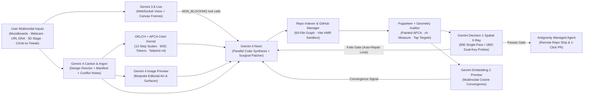

<div align="center">

# AntiSlop

### Multimodal Visual Frontend Design-Engineering Studio

[](https://ui-ux.fun)
[](https://ui-ux.fun/AntiSlop_Gemini4_OnePager.pdf)
[](https://antislop-engine-a53petnlfa-uc.a.run.app)

<br/>


</div>

---

**AntiSlop** is a multimodal visual frontend design-engineering studio that eliminates generic AI UI slop using deterministic perceptual color math, real browser physics, and calibrated visual critics. Instead of hoping a text prompt yields good taste, engineers feed AntiSlop moodboards, motion footage, webcam references, live voice direction, or target URLs—and watch a coordinated Gemini 4 + Vite HMR + Puppeteer loop synthesize, audit, and surgically ship production React/Tailwind code directly into real GitHub repositories.

---

## What's Inside (v2 Feature Matrix)

| Capability | Module / Surface | Technical Highlights |
| :--- | :--- | :--- |
| **Cobalt Diamond-Halftone Atelier Landing** | [`https://ui-ux.fun`](https://ui-ux.fun) · `studio/src/components/` | Interactive `Butterfly \| Koi Fish` live 20fps `Path2D` procedural diamond-halftone canvas shader with cobalt editorial framing and instant Studio entry. |
| **Multimodal Canvas & 3D Spatial Stage** | `studio/src/components/` | Freehand circle-to-tweak annotations, multi-image moodboards, physical webcam capture, reference URL DNA extraction, interactive 3D DOM layer perspective, and live code `Diff` inspection. |
| **Gemini 3.8 Live Bidirectional Voice Director** | `gemini-3.8-live` · WebSocket Bridge | Full-duplex voice + live canvas frame ingestion over WebSockets with `NON_BLOCKING` voice-to-code tool calls that patch the running Vite app in real time. |
| **900-Probe & 1,800 Dual-Key Sharded Decisions Spatial X-Ray** | `gemini-decision-1` · Decisions API | Zero-output-token calibrated probability matrix across 10×10 viewport tiles × 9 UI engineering pillars (900 probes in a single pass, or 1,800 probes sharded across dual API keys). |
| **OKLCH + APCA Perceptual Color Kernel & W3C Token Compiler** | [`backend/src/design/`](backend/src/design/) | 12-step functional scales, APCA-W3 `Lc` auto-repair, 10 curated palette archetypes, Machado CVD colorblindness simulation, and W3C `tokens.json` + Tailwind v4 `@theme` compilation. |
| **Computed-DOM Geometry & A11y Auditor** | [`backend/src/sandbox/geometryAuditor.ts`](backend/src/sandbox/geometryAuditor.ts) | Headless Puppeteer inspection of real painted APCA contrast, typographic `ch` measure, layout rhythm, minimum tap targets, overflow clipping, and semantic landmarks. |
| **Codebase-Scale Repo Dependency Graph & Surgical Patcher** | [`backend/src/sandbox/repoIndexer.ts`](backend/src/sandbox/repoIndexer.ts) · [`githubManager.ts`](backend/src/sandbox/githubManager.ts) | 60-file import/symbol dependency graph, relevance ranking, atomic search-replace patching, live GitHub repo cloning, and 1-click Pull Request creation. |
| **Managed Agent + Open-Source `SKILL.md` v2** | `antigravity-preview-09-2026` · [`skills/antislop-design-craft/SKILL.md`](skills/antislop-design-craft/SKILL.md) | Autonomous remote-repo engineering backed by AntiSlop's open-source Swiss typography, perceptual contrast, and anti-slop craft specification. |

---

## System Architecture



---

## Model Roster

| Model ID | Role in AntiSlop | Core Responsibilities |
| :--- | :--- | :--- |
| **`gemini-4-neon`** | High-Speed Frontend Code Engine | Primary React/Tailwind synthesis, parallel candidate racing, and atomic search-replace surgical patches into the live Vite HMR sandbox. |
| **`gemini-4-carbon`** | Frontier Design Director | Deep multimodal synthesis across moodboards, motion video, webcam frames, and URL DNA to produce typed `DesignManifest` specs and conflict resolutions. |
| **`gemini-4-argon`** | Structured Reasoning & Fast Audit Support | High-throughput architectural planning, design-system constraint checking, and structured JSON orchestration. |
| **`gemini-decision-1`** | Calibrated Spatial X-Ray & Taste Critic | Zero-output-token probability scoring across 900 single-pass or 1,800 dual-key sharded spatial probes (10×10 grid × 9 UI engineering pillars) plus slop/aesthetic gating. |
| **`gemini-3.8-live`** | Bidirectional Live Voice & Vision Director | Real-time WebSocket audio + canvas frame streaming with `NON_BLOCKING` function calling for hands-free voice-to-code design iteration. |
| **`gemini-4-image-preview`** | Bespoke Editorial Visual Generator | Generates domain-accurate hero photography, editorial illustrations, and subtle tactile surface textures matched to the active OKLCH palette. |
| **`antigravity-preview-09-2026`** | Managed Autonomous Repo Agent | Executes codebase-scale design refactors across cloned GitHub repositories using [`SKILL.md`](skills/antislop-design-craft/SKILL.md) and ships clean Pull Requests. |
| **`gemini-embedding-2-preview`** | Multimodal Taste Convergence Tracker | Computes image-to-image cosine similarity between reference moodboards and rendered sandbox screenshots to verify aesthetic convergence. |

---

## Empirical Benchmarks & Breaking Points

Automated controlled benchmarks ([`benchmarks/results/REPORT.md`](benchmarks/results/REPORT.md)) compare naive text-prompted generation against AntiSlop's multimodal loop on the identical `NovaFlow AI` slop baseline, evaluated via `gemini-decision-1`, `gemini-embedding-2-preview`, and deterministic Puppeteer DOM audits:

| Evaluation Group | Pass Rate | Taste Index (0–100 ↑) | AI Slop Penalty (0–10 ↓) | Aesthetic Match (0–10 ↑) | Typography (0–10 ↑) | Embed-2 Cosine ↑ |
| :--- | :---: | :---: | :---: | :---: | :---: | :---: |
| **Control (`text_baseline` — naive prompt)** | `0.0%` (0/3) | **13.8** | `9.09` | `1.52` | `5.62` | `0.554` |
| **AntiSlop v2 (`fast_demo` — single-pass fused)** | **`100.0%`** (3/3) | **99.5** *(+85.7)* | **`2.38`** *(-6.71)* | **`8.88`** *(+7.35)* | **`8.92`** | **`0.739`** |
| **Element 119 Chaos Stress Tests** *(4-way conflicts + glare webcam)* | **`100.0%`** (2/2) | **100.0** | **`1.58`** | **`9.12`** | **`9.16`** | `0.596` |

### Spatial X-Ray Performance & API Breaking Points
- **900-Probe Zero-Token Latency:** `~1.3–2.3s` end-to-end for a full 10×10 viewport × 9-pillar calibrated probability matrix using `gemini-decision-1` with zero generated output tokens.
- **1,000-Probe Hard API Cap Bypassed:** Stress testing uncovered a hard 1,000-probe ceiling per single Decisions API request. AntiSlop bypasses this cleanly with **1,800-probe dual-key sharding** (`2 × 900` concurrent shards across isolated API keys), doubling spatial resolution without sacrificing latency.
- **Full Failure Analysis:** Every stress-test failure, latency bottleneck, and architectural fix is documented openly in [`docs/BREAKING_POINTS.md`](docs/BREAKING_POINTS.md).

---

## Quick Start (Local Dev)

### 1. Configure Environment
Copy the environment template and add your Gemini API key(s) (plus optional GitHub token for 1-click PR shipping):

```bash
cp env/.env.example env/.env
```

> See [`env/README.md`](env/README.md) for all supported variables, including dual-key sharding for 1,800-probe Spatial X-Ray runs. Secrets in `env/.env` are strictly gitignored.

### 2. Start the Backend Engine (Express + Vite HMR + Puppeteer)
```bash
cd backend && npm install && npm run dev
```

### 3. Start the Studio IDE (Next.js 15)
In a second terminal:
```bash
cd studio && npm install && npm run dev
```

Open **`http://localhost:3000`** to launch AntiSlop Studio locally.

### Recommended Test Repositories
Clone or paste any of these public GitHub repositories directly into AntiSlop Studio's GitHub import bar to test codebase-scale indexing, surgical patching, and 1-click PR generation:
- [`tailwindtoolbox/Landing-Page`](https://github.com/tailwindtoolbox/Landing-Page)
- [`themesberg/landwind`](https://github.com/themesberg/landwind)
- [`leoMirandaa/shadcn-landing-page`](https://github.com/leoMirandaa/shadcn-landing-page)

---

## Repository Structure

```text
.
├── backend/                     # Express API, Gemini 4 orchestration, Vite HMR & Puppeteer sandbox
│   └── src/
│       ├── config/              # Model IDs, env loaders, and runtime configuration
│       ├── design/              # OKLCH + APCA colorKernel, paletteArchetypes & W3C tokenCompiler
│       ├── gemini/              # Carbon, Neon, Argon, Decision-1 X-Ray, 3.8 Live & Managed Agent clients
│       ├── orchestrator/        # Multi-model design-critique-repair loop
│       ├── routes/              # REST, SSE & WebSocket endpoints
│       ├── sandbox/             # geometryAuditor, repoIndexer, githubManager, viteManager & puppeteerAuditor
│       ├── types/               # Backend-internal type definitions
│       └── server.ts            # Main HTTP/WS entrypoint
├── studio/                      # Next.js 15 + Tailwind v4 visual frontend design IDE
│   └── src/
│       ├── app/                 # App Router pages (Atelier landing + Studio workspace)
│       ├── components/          # Diamond-halftone shader, 3D stage, X-Ray overlay, Diff & Live Voice UI
│       └── lib/                 # API clients, WebSocket audio/frame bridge & state helpers
├── shared/                      # Locked cross-package TypeScript contracts
│   └── types.ts
├── skills/                      # Open-source Design Craft Agent Skill (v2)
│   └── antislop-design-craft/
│       └── SKILL.md
├── benchmarks/                  # 5 Sigma empirical evaluation harness & saved results
│   └── results/
│       ├── REPORT.md
│       └── latest-report.json
├── docs/                        # Architecture, build logs, breaking points, ADRs & executive PDFs
│   ├── ADR/                     # Architecture Decision Records (001–004)
│   ├── ARCHITECTURE.md
│   ├── BREAKING_POINTS.md
│   ├── BUILD_LOG.md
│   ├── CASE_STUDY_ORIGIN.md
│   ├── DEMO_PLAYBOOK.md
│   ├── PARALLEL_BUILD_PLAN.md
│   ├── AntiSlop_Gemini4_OnePager.pdf
│   └── How_AntiSlop_Works_OnePager.pdf
├── deploy/                      # Cloud Run & container deployment manifests
├── env/                         # .env.example template and setup guide
├── scripts/                     # Automation & verification scripts
├── target-repo/                 # Embedded default Vite/React sandbox target
└── target-templates/            # Baseline starter templates for controlled benchmarks
```

---

## Engineering Documentation

- **[System Architecture](docs/ARCHITECTURE.md)** — Multi-model Gemini 4 choreography, Decisions API rubric, and Cloud Run + Vercel topology
- **[Breaking Points & Failure Analysis](docs/BREAKING_POINTS.md)** — Honest stress-test failures, 1,000-probe API cap discovery, and architectural fixes
- **[5 Sigma Benchmark Report](benchmarks/results/REPORT.md)** — Full empirical metrics comparing naive prompting vs. AntiSlop v2
- **[Design Craft Skill (`SKILL.md` v2)](skills/antislop-design-craft/SKILL.md)** — Swiss typography, OKLCH/APCA contrast math, and anti-slop ruleset
- **[Live Demo & Judge Playbook](docs/DEMO_PLAYBOOK.md)** — End-to-end live walkthrough and Q&A guide
- **[Engineering Build Log](docs/BUILD_LOG.md)** & **[Origin Case Study](docs/CASE_STUDY_ORIGIN.md)** — Timestamped build journal and motivation
- **[Parallel Build Plan](docs/PARALLEL_BUILD_PLAN.md)** — Multi-agent ownership boundaries
- **[Shared Type Contract](shared/types.ts)** & **[Environment Guide](env/README.md)**
- **Architecture Decision Records (ADRs):**
  - [ADR-001: Official `@google/genai` SDK over LangChain](docs/ADR/001-official-genai-sdk-over-langchain.md)
  - [ADR-002: AntiSlop Studio Canvas IDE vs. Metrics Dashboard](docs/ADR/002-studio-canvas-not-dashboard.md)
  - [ADR-003: Parallel Tier-3 Racing & Calibrated Decisions API Critic](docs/ADR/003-parallel-tier3-racing-and-decisions-critic.md)
  - [ADR-004: Hybrid Cloud Run + Vercel & Antigravity Managed Agents](docs/ADR/004-hybrid-cloud-run-vercel-and-managed-agents.md)
