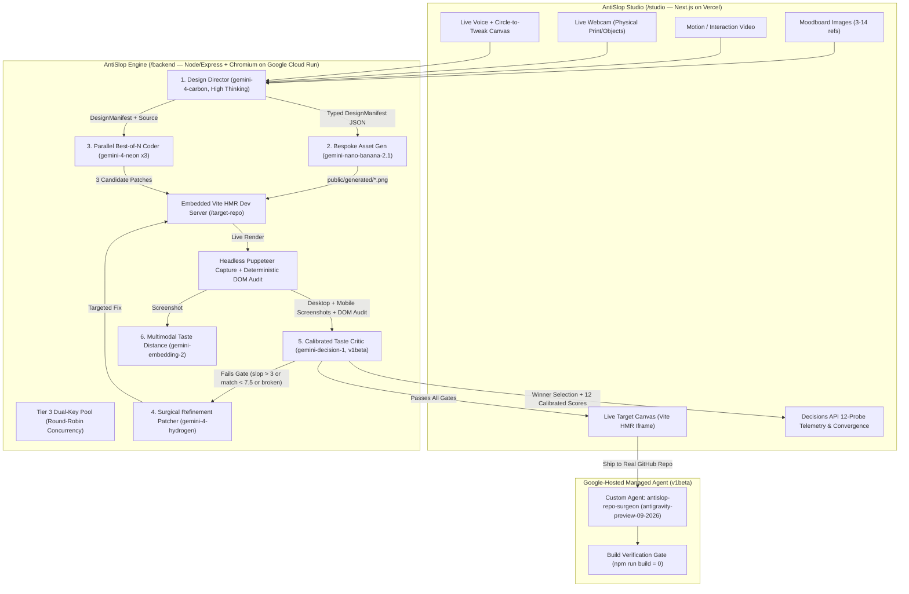

# AntiSlop System Architecture

> **Target Problem Statements:** Problem Statement Two (**Element 119** — Multimodal Limits & Decisions API) + Problem Statement One (**5 Sigma** — Empirical Reliability vs. Baseline) + Bonus Track (**Managed Agents**, `antigravity-preview-09-2026`).

---

## 1. Core Thesis: Why Taste Cannot Be Prompted in Text

Every frontier coding model produces recognizable **AI UI Slop** when asked in text to *"make it look modern and premium"*: indigo-to-purple gradients, crowded rounded shadow-cards, generic Inter typography, and stock icon badges.

Text collapses visual nuance (paper warmth, typographic tension, whitespace cadence, tactile borders, cubic-bezier hover physics) into a generic statistical average. **AntiSlop** eliminates text-prompt guesswork by keeping raw media (moodboard screenshots, UI motion recordings, physical objects via webcam, spoken art direction) as first-class multimodal inputs and closing the loop with calibrated visual evaluation via **`gemini-decision-1`**.

---

## 2. Multi-Model Gemini 4 Choreography

Every model has a sharp, non-overlapping responsibility — designed to maximize **Tier 3 API throughput** via parallel candidate racing and single-pass Decisions API scoring:

| Role | Model / Surface | API Surface | Why This Exact Model |
| :--- | :--- | :--- | :--- |
| **Multimodal Design Director** | `gemini-4-carbon` (`thinking_level: "high"`) | `v1` Interactions API | Deepest frontier reasoning over mixed moodboard images, motion video, webcam captures, and voice transcripts to synthesize a strict `DesignManifest` + conflict resolution notes. |
| **Parallel Code Architect (Best-of-N)** | `gemini-4-neon` (`thinking_level: "high"`) | `v1` Interactions API | Fast frontier end-to-end coding; spawns **N=3 parallel architectural interpretations** simultaneously (leveraging Tier 3 concurrency) so the visual critic picks the strongest foundation. |
| **Sub-Second Surgical Patcher** | `gemini-4-hydrogen` (`thinking_level: "medium"`) | `v1` Interactions API | Ultra-fast targeted React/Tailwind edits for **Circle-to-Tweak** canvas annotations and iterative Decisions API refinements. |
| **Calibrated Visual Taste Critic** | `gemini-decision-1` (`0` output tokens) | `v1beta` Decisions API | Evaluates **12 independent `score`, `noul`, and `choice` questions** in a single ~200ms prefill pass over `(Reference Moodboard + Rendered Puppeteer Screenshot)`. Zero token-generation drift; calibrated probabilities + confidence scores. |
| **Bespoke Editorial Asset Studio** | `gemini-nano-banana-2.1` | `v1` Interactions API | Multi-image reference fusion (up to 14 moodboard references) to generate custom hero imagery & surface textures saved straight into `/target-repo/public/generated/`. |
| **Voice Art Direction** | `gemini-3.5-transcribe` / `gemini-3.8-live` | `v1` / Live WebSocket | Converts live spoken art direction into structured design cues without touching a keyboard. |
| **Taste Convergence Vectorizer** | `gemini-embedding-2` | `embedContent` | Embeds reference moodboards + rendered screenshots into a shared multimodal vector space to compute mathematical cosine similarity convergence across iterations (5-Sigma proof). |
| **Remote Repo Surgeon ($5K Track)** | `antigravity-preview-09-2026` (`client.agents.create`) | `v1beta` Managed Agents | Custom named agent (`antislop-repo-surgeon`) running in a Google-hosted remote Linux sandbox (`environment: "remote"`), mounting real GitHub repos, applying the verified Design Manifest, and gating changes with deterministic build verification. |

---

## 3. End-to-End Architecture Diagram



---

## 4. Decisions API 12-Probe Visual Rubric (`gemini-decision-1`)

In one ~200ms prefill pass (`0` output tokens), `ai.decisions.create()` evaluates the rendered live screenshot alongside the raw moodboard references:

1. `aesthetic_match` (`score`, 0–10): Alignment with moodboard warmth, surface texture, and visual mood.
2. `slop_penalty` (`score`, 0–10, lower is better): Presence of AI UI clichés (indigo/purple gradients, generic SaaS glow-cards, lifeless stock hierarchy).
3. `typography_craft` (`score`, 0–10): Editorial contrast, scale tension, line height, and display/body pairing fidelity.
4. `visual_rhythm` (`score`, 0–10): Breathing room, grid discipline, intentional asymmetry, anti-clutter pacing.
5. `color_harmony` (`score`, 0–10): Fidelity to extracted palette without muddy midtones or harsh neon leaks.
6. `motion_cohesion` (`score`, 0–10): Visual consistency of hover/affordance/interactive cue styling with the reference style.
7. `layout_broken` (`noul`): Calibrated probability of overlapping text, clipped buttons, broken grids, or horizontal overflow.
8. `contrast_failing` (`noul`): Calibrated probability of illegible text over backgrounds or generated hero images.
9. `generic_ai_cliche` (`noul`): Calibrated probability that a senior designer would immediately clock this as default AI output.
10. `production_ready` (`noul`): Calibrated probability that this page looks like a handcrafted studio launch.
11. `dominant_aesthetic_class` (`choice`): Classifies the rendered result (`editorial_print`, `swiss_minimal`, `brutalist_studio`, `warm_craft`, `generic_ai_slop`, `broken_layout`).
12. `primary_defect_class` (`choice`): Pinpoints the #1 surgical fix for the next iteration (`none`, `ai_slop_styling`, `contrast_legibility`, `typography_weak`, `layout_collision`, `palette_mismatch`, `generic_imagery`).

Combined with Puppeteer's **deterministic DOM audit** (exact horizontal overflow pixels, bounding-box text overlap detection, broken `` tags, runtime console errors), the critic loop cannot hallucinate a passing grade!

---

## 5. Repository Layout

```text
antislop/
├── env/
│   ├── .env.example          # Master environment template (committed)
│   ├── .env                  # Local secrets (GITIGNORED — never committed!)
│   └── README.md             # 30-second API key setup guide
├── shared/
│   └── types.ts              # Locked TypeScript contract across all subsystems
├── target-repo/              # Realistic "AI UI Slop" Vite + React + Tailwind baseline app
├── backend/                  # Express + @google/genai + Vite HMR + Puppeteer + Managed Agents
├── studio/                   # AntiSlop Studio (Next.js live multimodal canvas IDE)
├── benchmarks/               # 5-Sigma baseline vs AntiSlop + Element 119 stress-test runner
├── deploy/                   # Cloud Run Dockerfile, cloudbuild.yaml, Vercel config
└── docs/
    ├── ARCHITECTURE.md       # System design (this file)
    ├── PARALLEL_BUILD_PLAN.md# Multi-agent parallel build plan & ownership boundaries
    ├── BUILD_LOG.md          # Timestamped hackathon build journal for judges
    ├── BREAKING_POINTS.md    # Honest Element 119 / 5-Sigma failure & fix log
    └── ADR/                  # Architecture Decision Records
```
